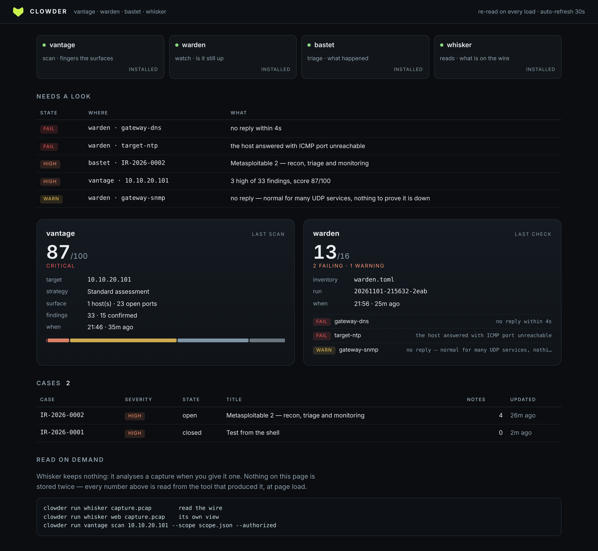

# clowder

One front door for the four tools in this lab.

A clowder is a group of cats. This one gathers [Vantage](https://github.com/Noxwer-beep/vantage)
(scans), [Warden](https://github.com/Noxwer-beep/warden) (watches services),
[Bastet](https://github.com/Noxwer-beep/bastet) (triage and cases) and
[Whisker](https://github.com/Noxwer-beep/whisker) (reads captures) into one dashboard and
one command line — and owns none of their logic.

```
 /\_/\      CLOWDER  1.0.0
( o.o )     a group of cats is a clowder
 > ^ <      vantage · warden · bastet · whisker

TOOL      DOES                          STATE   DATA
vantage   scan · fingers the surfaces   ok      ~/.local/share/vantage
warden    watch · is it still up        ok      ~/lab/.data
bastet    triage · what happened        ok      ~/.local/share/bastet
whisker   reads · what is on the wire   ok      ~/.local/share/whisker

ATTENTION  across all four

STATE   WHERE                     WHAT
critical bastet · IR-2026-0002    Metasploitable 2 — recon, triage and monitoring
fail    warden · gateway-dns      no reply within 4s
high    vantage · 10.10.20.101    3 high of 33 findings, score 87/100
warn    warden · gateway-snmp     no reply — normal for many UDP services
```



## The rule

**Clowder reads. It never recomputes.**

Every number on that page comes from the tool that produced it, read at page load: the
last `report.json` Vantage wrote, the newest row in Warden's `runs` table, the open
cases in Bastet's database. There is no second implementation of a risk score, a health
verdict or a severity — because two implementations of a judgement is two truths that
drift, and the one on the dashboard would be the one nobody tested.

What it does add is the thing no single tool can know: **one attention list across all
four**, ranked on a single scale.

| rank | what it means |
|---|---|
| `critical` | a confirmed critical finding — someone can walk in |
| `fail` | a service that is supposed to be up is not |
| `high` / `warn` | a high finding, or a service that answered badly |
| `medium` | a medium finding |
| `low` / `unknown` | worth knowing, not worth waking up for |

## Install

```bash
pip install clowder            # console only
pip install "clowder[ui]"      # plus the browser dashboard
```

Or from a checkout: `./clowder`.

The four tools are separate installs. Clowder finds them on `PATH` first, then at
`~/projects/<name>/<name>`, and says `missing` when it finds neither — it does not
pretend, and it does not install anything for you.

## Commands

```
clowder                         the dashboard
clowder status --json           the same, machine-readable
clowder doctor                  what is installed, where does it keep state
clowder web                     the dashboard in a browser (port 8780)

clowder vantage scan 10.10.20.101 --scope scope.json --authorized
clowder warden check
clowder bastet case list
clowder whisker capture.pcap
clowder run warden check        the long form of the same thing
```

The shortcuts are not a re-implementation: `clowder warden check` execs `./warden check`
with the same argv and returns **its** exit code. If a tool fails, the console fails
with the tool's number, so it drops into a script exactly like the tool would.

Exit codes: `0` ok · `1` error · `2` unknown tool · `3` tool missing · `4` attention at
or above `--fail-on` (accepts `critical`, `fail`, `high`, `warn`, `medium`, `low`).

## Where the data is

Nothing is copied. Each tool keeps its own state, and Clowder is told where:

| tool | default | environment |
|---|---|---|
| vantage | `~/.local/share/vantage` | `VANTAGE_DATA_DIR` |
| warden | `~/.local/share/warden` | `WARDEN_DATA_DIR` |
| bastet | `~/.local/share/bastet` | `BASTET_DATA_DIR` |
| whisker | — | `WHISKER_DATA_DIR` (analyses on demand, stores nothing) |

A store that lives somewhere else — mine keeps the lab inventories next to the
`warden.toml` they belong to — goes in a config file:

```toml
# ~/.config/clowder/config.toml
[data]
warden = "/home/nox/lab/.data"
```

Environment beats the config file, and the config file beats the default.

## What it reads, exactly

| tool | source | fields |
|---|---|---|
| vantage | `reports/<scan_id>/report.json` (newest) | target, strategy, hosts, ports, counts, score, grade |
| warden | `warden.db` → `runs`, `checks` | last run counts, plus failing/warning services |
| bastet | `cases.db` → `cases`, `events` | open cases, severity, event count |
| whisker | nothing | shown as "on demand" — it analyses a capture when given one |

Every reader is defensive on purpose. A missing database, a half-written report or a
database from an older schema produces a line under `doctor`, never a traceback: the
console is the thing you open *because* something else is broken.

## Tests

```bash
python3 -m unittest discover -s tests -t .
```

30 tests, no network. They build real `report.json` files and real SQLite databases with
the same schemas the tools use, including a deliberately broken one and an older schema,
because "the other tool's database is a mess" is a Tuesday, not an exception. The
passthrough test runs an actual shell script and checks that the console returns *its*
exit code.

## Licence

MIT.
